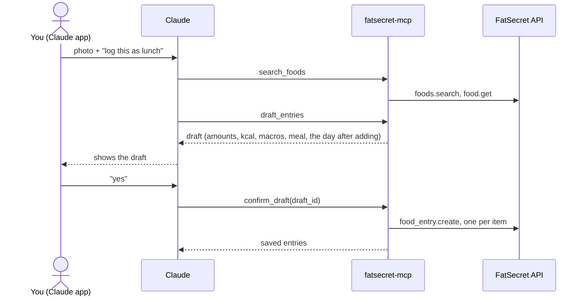
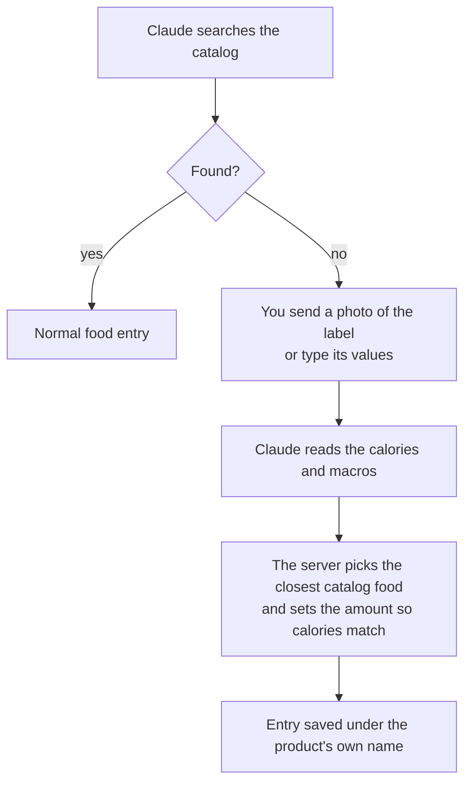
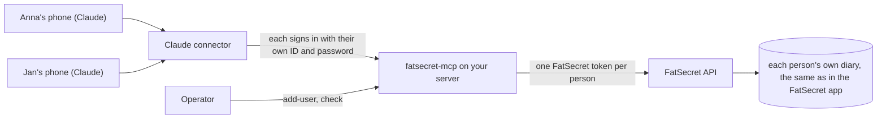

# fatsecret-mcp

[](https://github.com/jaronskijakub/fatsecret-mcp/actions/workflows/ci.yml)
[](pyproject.toml)
[](LICENSE)

Log food to your FatSecret diary by talking to Claude on your phone. Claude shows you a draft first, and nothing is saved until you say yes.

<!-- DEMO VIDEO: a 20–30 second phone recording goes here (photo of a nutrition label → the draft → "yes" → the entry in the FatSecret app). Upload the MP4 through GitHub's web editor so it plays inline. -->

> **Demo video coming soon.** It will show a photo of a nutrition label, the draft Claude proposes, a "yes", and the new entry in the FatSecret app.

fatsecret-mcp is a self-hosted [MCP](https://modelcontextprotocol.io) server. It connects Claude to your own [FatSecret](https://www.fatsecret.com) food diary, the one you see in the FatSecret app. Claude can read a day or a few weeks of it against your daily calorie and macro targets. It can find foods in the FatSecret catalog and draft entries from a description or a photo. Each draft shows the amounts, calories, macros, a suggested meal and how your day looks after adding it. When a packaged product isn't in the catalog, a photo of its nutrition label is enough.

One server serves a household: a few people, each signed in with their own FatSecret account. There's no public instance, so you run your own.

This project is unofficial. It is not affiliated with or endorsed by FatSecret, and it is not medical or dietary advice.

[Powered by fatsecret Platform API](https://platform.fatsecret.com)

## What you can ask

The server gives Claude five tools. You never call them yourself; you just talk.

### `search_foods`

Finds foods in the catalog with servings that can be logged.

> **You:** How many calories are in a cup of cooked jasmine rice?
>
> **Claude:** FatSecret has "Jasmine Rice (cooked)": 1 cup (158 g) is 205 kcal, 4.3 g protein, 0.4 g fat, 44.5 g carbohydrate.

### `draft_entries`

Proposes entries without writing anything.

> **You:** *(photo of a plate)* Log this as lunch.
>
> **Claude:** Here's the draft for lunch today:
> - Beef bibimbap, 1 bowl (480 g): 640 kcal, 32 g protein, 21 g fat, 80 g carbohydrate
>
> I assumed one restaurant-sized bowl. After adding it you'll be at 1,420 of 2,200 kcal and 78 of 140 g protein. Save it?

### `confirm_draft`

Writes the draft you approved.

> **You:** Yes.
>
> **Claude:** Saved. Beef bibimbap is in your FatSecret diary under lunch.

### `get_diary_day`

Reads one day with its totals and what's left of your targets.

> **You:** How much is left today?
>
> **Claude:** You've had 1,420 kcal. 780 kcal are left, along with 62 g protein, 18 g fat and 95 g carbohydrate.

### `get_period_summary`

Reads daily totals for up to 31 days.

> **You:** How did my week go compared with the week before?
>
> **Claude:** This week you averaged 2,050 kcal and 128 g protein a day; last week 2,240 kcal and 117 g protein. You went over your calorie target on two days this week, and on four the week before.

The numbers above are illustrative.

## How a meal gets logged



The draft is signed by the server and expires after thirty minutes. It can only be confirmed by the person it was made for. In Claude's connector settings, keep `confirm_draft` on "Needs approval" so that every write asks you first.

## Products the catalog doesn't have

A free FatSecret API key reaches only the US catalog, in English. Most local and branded products aren't in it. For those, Claude asks for a photo of the nutrition label, or you type its values. The server logs the product as a stand-in: the closest catalog food, in the amount whose calories match the label, under the product's own name.



Calories match the label exactly; macros are close but approximate. Opening the entry's details in the FatSecret app shows the catalog food underneath. The server rejects a label whose calories don't roughly agree with its macros, which catches a misread photo or kJ taken for kcal. It doesn't remember stand-ins: next time, Claude reuses the label from the conversation or asks again.

If you log a product often, adding it once in the FatSecret app (which scans barcodes) gives you exact values there.

## What it doesn't do

- It can't look up barcodes, regional catalogs such as a Polish one, or custom foods. A free key reaches only the US catalog, so Claude searches it in English.
- It can't edit or delete entries. Do that in the FatSecret app.
- It doesn't track weight, exercise or recipes, only food entries.
- It doesn't serve strangers. There's no public server, and each server has a fixed list of people.

## Run your own

A household server has one **Operator**, the person who deploys it and adds everyone else. Each person in the household signs in to FatSecret once through the Operator, then adds the server to their own Claude account as a custom connector.



You need:

- your own FatSecret Platform API key. Register at [platform.fatsecret.com](https://platform.fatsecret.com); the free Basic plan is enough. Using it means accepting FatSecret's [API terms](https://platform.fatsecret.com/terms). This project ships no keys;
- a container host with HTTPS for the server, such as Railway;
- a Claude account for each person, with custom connectors available on their plan.

The short path:

1. Create a `.env` with your FatSecret key and a signing key, then run `add-user` once per person ([setup](docs/setup.md)).
2. Deploy the image `ghcr.io/jaronskijakub/fatsecret-mcp` with those values ([deploy](docs/deploy.md)).
3. In Claude, add `https://<your-server>/mcp` as a custom connector and sign in ([connector](docs/connector.md)).

To try it on your own computer first, run it over stdio with Claude Code; [setup](docs/setup.md#run-it-with-claude-code) covers that too. Request quotas, pacing and caching are described in [limits](docs/limits.md), and the trust model in [SECURITY.md](SECURITY.md).

## Documentation

- [Setup](docs/setup.md): configuration, adding people, their settings, and running it locally with Claude Code.
- [Deploy](docs/deploy.md): Railway, other container hosts, Docker, and building the image yourself.
- [Connector](docs/connector.md): adding the server to Claude, sign-in, and signing someone out.
- [Limits](docs/limits.md): the daily quota, pacing, search, drafts and input sizes.
- [Changelog](CHANGELOG.md): what changed in each version.

Report vulnerabilities through [SECURITY.md](SECURITY.md), which also describes the trust model and what is stored where.

## Roadmap

- Edit and delete food entries, starting with "undo that" right after a wrong save.
- Custom foods for users with a FatSecret Premier key, so a branded product can be logged with exact values instead of a stand-in.
- Open Food Facts lookups for products the US catalog lacks, by name or barcode.
- Your own recent foods. Products you often log aren't searched yet; reading them from your diary took too many API requests, so this needs another approach.
- Remember products logged from a label, so a stand-in doesn't need the photo again. This needs persistent storage.
- Native confirmation dialogs in Claude for saving a draft, instead of a "yes" in the chat.

## Development

```sh
uv sync
uv run ruff check && uv run ruff format --check
uv run pyright
uv run pytest
```

The tests never call FatSecret. They replay recorded responses from `tests/fixtures/fatsecret/`. An opt-in smoke test reads your real diary: `FATSECRET_LIVE_SMOKE=1 uv run --env-file .env pytest tests/test_live_smoke.py`. Container tests are described in [deploy](docs/deploy.md#build-and-test-the-image).

## License

[MIT](LICENSE)
